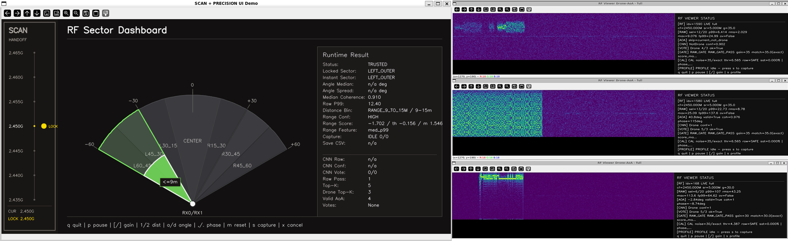

# 김건태 | 엔지니어링 포트폴리오

**전자공학 · 회로 구현 · RF 신호처리 · 자동화·비전 AI**

전자공학을 바탕으로 실물 회로를 만들고, SDR 수신부터 신호 판단·방향 추정·시각화까지 연결했습니다. 전기·설비 현장의 시공 경험을 토대로 PLC·로봇 교육과 비전 AI 팀 프로젝트로 경험을 확장하고 있습니다.

**[종합 포트폴리오 PDF · 9쪽](public/downloads/engineering-portfolio.pdf)** · [PDF 원본 다운로드](https://raw.githubusercontent.com/rjsxo943-gif/engineering-portfolio/main/public/downloads/engineering-portfolio.pdf) · [전체 경험 상세](docs/experience/README.md)

## 핵심 경험

**[RF · 데이터 기반 진단](docs/experience/rf-drone.md)** 
외부 데이터 1,800개의 Gain별 조건을 분석하고, 동일 데이터 재평가에서 오탐 300건 → 12건으로 감소.

**[회로 · 실물 디버깅](docs/experience/digital-clock.md)** 
시계의 자리올림 오류와 과전류를 계측·IC 분리시험으로 진단하고 수정 후 재검증.

**[운영 · 검토 가능한 기록](docs/experience/student-council.md)** 
학생회 연간 약 2,200만 원·8개 주요 행사 재정 기록과 결재·증빙 절차 관리.

## 프로젝트

| 프로젝트 | 본인 역할 | 상태¹ |
|---|---|---|
| [RF 드론 탐지·방향 추정](docs/experience/rf-drone.md) | IQ 수신·신호처리·AoA·실시간 화면 통합 및 야외 검증 | 완료 · 졸업작품 |
| [TTL/CMOS 디지털 시계](docs/experience/digital-clock.md) | 회로 설계·배선·납땜, 자리올림 오류·과전류 진단 | 완료 |
| [K2 스마트팩토리](docs/experience/smart-factory.md) | YOLO 기반 탑뷰 비전 검사 검토·개발 및 검사 신호 정의 참여 | 완료 수준 확인 필요 |
| [AI 분실물 관제탑](docs/experience/lost-found.md) | 탑뷰 검출·좌표 변환·특징 매칭과 로봇 연계 담당 | 진행 중 |

### RF 탐지 시스템 화면

[RF 프로젝트 공개 원본](https://github.com/rjsxo943-gif/rf-drone-detection-capstone/blob/main/assets/dashboard_scan_precision.png). 왼쪽은 scan·precision UI 데모, 오른쪽은 RF 신호 확인 화면입니다. 거리 표시는 실험적 구간 정보입니다.

## 교육 · 현장 · 조직 운영

**[Intel / 피지컬 AI 부트캠프](docs/experience/bootcamp.md)** · 교육 실습 · 수강 중 
PLC·센서·공압·로봇 티칭·핸드셰이크 교육 실습.

**[전기·설비·내장 현장](docs/experience/field-work.md)** · 완료 · 현장 참여 
대유기전 전기·아성설비 배관·NCT 내장 시공 참여.

**[학생회 총무부장](docs/experience/student-council.md)** · 완료 
예산·증빙·환불 기록, 다단계 결재와 감사자료집 제작.

## 기술 경험

| 경험 수준 | 도구·기술 |
|---|---|
| 직접 사용 | TTL/CMOS · Proteus · 납땜·배선 · 오실로스코프 · Pluto+ SDR · Python · STFT · CNN · AoA · OpenCV |
| 프로젝트 진행 중 | YOLO · ArUco · 호모그래피 · 비전 특징 매칭 · SO-101 연계 |
| 교육·예제 실습 | GX Works2 · PLC 래더 · 공압 · Conty 3.3 · Python 로봇 제어 · CC-Link |

## 자료 안내

- **PDF 구성:** 1쪽 소개 / 2–3쪽 RF·팀 포스터 / 4쪽 시계 / 5쪽 K2 / 6쪽 교육 / 7쪽 분실물 / 8쪽 현장 / 9쪽 학생회
- GitHub PDF 미리보기에서 일부만 보이면 [원본 PDF를 다운로드](https://raw.githubusercontent.com/rjsxo943-gif/engineering-portfolio/main/public/downloads/engineering-portfolio.pdf)해 전체 9쪽을 확인할 수 있습니다.
- **저장소 QR:** [PNG · 인쇄용](public/downloads/github-repository-qr.png) / [SVG · 벡터](public/downloads/github-repository-qr.svg). 이 GitHub 포트폴리오의 메인 페이지로 연결됩니다.

¹ 경험·진행 상태 기준: **2026.11.09**. 완료·진행·교육 실습을 구분하며, 개인 수행과 팀 결과는 각 상세 문서에 정리했습니다. RF 오탐 수치는 Gain별 판단 기준의 동일 데이터 비교로, RawNoiseGate·voting 실험과 별개입니다.

사이트 개발·유지보수

[개발 환경](docs/development.md) · [콘텐츠·사진 관리](docs/maintenance.md) · [배포](docs/deployment.md)

