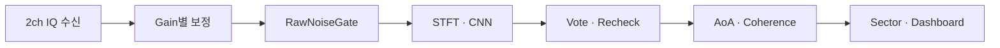
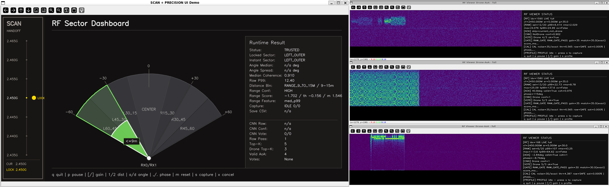
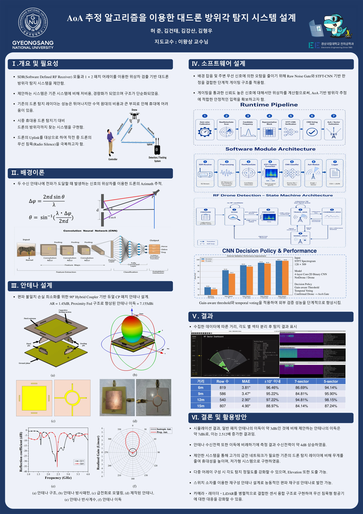

[포트폴리오 처음으로](../../README.md) · [전체 경험](README.md) · [종합 PDF · 2–3쪽](../../public/downloads/engineering-portfolio.pdf)

# SDR 기반 RF 드론 탐지 및 AoA

**완료 · 졸업작품** · 2026.03 — 2026.06

Pluto+ SDR의 2채널 IQ 신호를 수집하고, CNN 후보 검증과 위상차 기반 방향 추정을 실시간 화면으로 연결한 RF 탐지 계층 prototype.

## 본인 역할

- 2채널 IQ 수신·전처리와 gain/phase/noise calibration 구성
- STFT·CNN 추론, RawNoiseGate, 후보 vote·동일 주파수 재검증 연계
- 위상차 AoA·coherence 검증·sector 안정화 및 OpenCV dashboard 통합
- 야외 시험과 CSV replay 기반 검증

## 문제 해결과 확인 결과

### 내부 성능과 다른 외부 데이터 오탐

- **대응:** 별도 날짜의 외부 데이터 1,800개를 Gain별로 분리해 비교하고, Gain별 판단 기준을 적용했습니다.
- **결과·현재 상태:** 동일 외부 데이터 재평가에서 오탐 300건 → 12건. RawNoiseGate·voting 실험과는 별도 비교입니다.

### 방향 추정의 순간적인 튐

- **대응:** 탐지 유효 상태와 coherence를 확인하고, sector voting으로 출력 방향을 안정화했습니다.
- **결과·현재 상태:** 신뢰도가 낮은 각도는 제외하고 scan → precision → 신호 소실 시 복귀 흐름을 통합했습니다.

## 시스템 처리 흐름

## 팀·조직의 범위

팀은 안테나 하드웨어와 수신·소프트웨어를 결합한 졸업작품 prototype을 구현했습니다. 안테나 설계·제작을 포함한 팀 전체 결과와 아래 개인 수행 범위를 구분합니다.

## 범위와 한계

상용 대드론 제품이 아닙니다. 거리 출력은 실험적 대략 구간이며 정밀 거리 측정이 아닙니다. 다양한 환경의 일반화와 장시간 안정성 검증은 추가 과제입니다.

## 공개 화면과 자료

[화면 원본](https://github.com/rjsxo943-gif/rf-drone-detection-capstone/blob/main/assets/dashboard_scan_precision.png) · 왼쪽 scan·precision UI 데모 / 오른쪽 RF 신호 확인 화면

졸업작품 팀 포스터

팀 전체 결과이며, 본인 역할은 위 개인 수행 범위에 명시했습니다.

## 관련 링크

- [프로젝트 README](https://github.com/rjsxo943-gif/rf-drone-detection-capstone)
- [최종 검증](https://github.com/rjsxo943-gif/rf-drone-detection-capstone/blob/main/docs/results/final_validation_summary.md)
- [개인 기여 원문](https://github.com/rjsxo943-gif/rf-drone-detection-capstone/blob/main/docs/interview/project_story.md)
- [시스템 블록 원본](https://github.com/rjsxo943-gif/rf-drone-detection-capstone/blob/main/assets/system_architecture_from_poster.png)

**사용·학습 기술:** Pluto+ SDR · Python · STFT / CNN · AoA · OpenCV

---

기록 기준 2026-11-09. [TTL/CMOS 디지털 시계 →](digital-clock.md)
